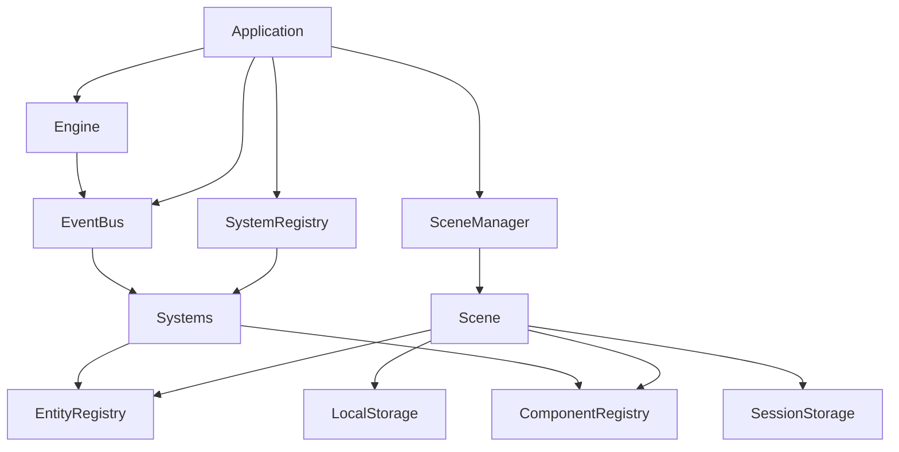
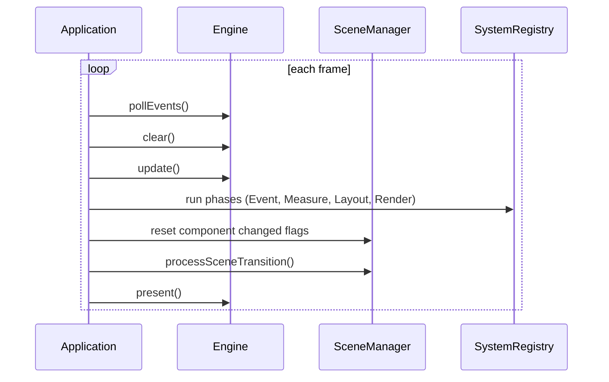
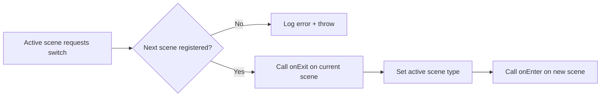

# Guillaume Architecture

Guillaume is organized around an entity-component-system model so UI state,
presentation, and interaction logic stay separate.

## Module Layout

- **Application** owns the engine, scene manager, event bus, and system
  registry, and drives the main loop.
- **SceneManager** owns the registered scenes and handles transitions.
- **Scene** owns an entity registry and a component registry.
- **Systems** read components and traverse entities each frame.
- **EventBus** routes typed events to subscribed listeners and systems.
- **Storage** (`LocalStorage`/`SessionStorage`) provides key-value persistence.

## Frame Lifecycle

The main loop is single-threaded: input → update → render → present.

## Scene Transition Flow

## How the ECS Is Used

Guillaume stores state the ECS way and composes UI the widget way:

- **Components** are plain state (`Bound`, `Transform`, `Color`, `Layout`,
  interaction flags…), stored per type in the scene's
  `ecs::ComponentRegistry`. Storage for a component type is created the first
  time it is added; there is no central list to register a new component in.
- **Systems** own everything that happens every frame for a kind of
  component: input hit-testing, measuring, layout, rendering. Each system
  declares the components it needs and a phase.
- **Entities are thin facades.** An entity class such as `Button` or
  `NavigationDrawer` holds no state and no rule. It creates its components
  and child entities, and its setters write components and call the
  system's static functions so a change is visible at once. The framework
  never calls back into an entity: `ecs::System::routine` only calls the
  system's `update(identifier)`.

Every widget of the library follows this shape. A system can be driven on a
bare identifier with the right components, which is how the system tests
under `tests/sources/systems/` work.

### Widget shape and how to add one

`Divider` is the reference. It is split in three:

| Piece | File | Holds |
|---|---|---|
| `components::Divider` | `components/divider.hpp` | Every piece of state: variant, length, thickness, inset, color, origin pose. |
| `systems::Divider` | `systems/divider.hpp` | Every rule: it turns the configuration into `Transform`, `Bound`, `Line` and `Color`, each frame in the Measure phase. |
| `entities::Divider` | `entities/divider.hpp` | No fields and no `update()`. A facade whose setters write the component, kept so existing code compiles. |

`systems/test_divider.cpp` drives the system on a bare identifier with five
components and no `entities::Divider` object at all.

To write a widget (this is also how the existing ones were migrated):

1. Move each member field of the entity class into a `components::X`
   configuration component. Setters compare before writing and call
   `setHasChanged(true)`, so an unchanged value never marks the entity dirty.
2. Move the body of `update()`, `applyGeometry()`, `applyStyleState()` and
   friends into `systems::X`, as a static `apply(registry, identifier)` that
   reads and writes components only, plus an `update()` override that calls
   it. Pick the phase by what it produces: Measure for intrinsic size, Layout
   for child placement, Event for state driven by input.
3. Register the system in `sources/systems/core_systems.cpp`.
4. Reduce the entity class to a facade: add `components::X` to its
   `EntityFiller` list, make each setter write the component and call
   `systems::X::apply` (so the result is visible immediately while a scene is
   being built), and delete its `initialize()` / `update()` overrides.
5. Test the system on bare identifiers, without the entity class.

Widgets with children read the tree from `components::Hierarchy` (parent
identifier, child identifiers, layer). Every entity built on a component
registry has one, and `ecs::Entity::setParent()` keeps it up to date, so a
system can place children or compute depth from identifiers without the
entity object. Systems treat it as read-only.

`entities::SurfaceBase`, the base of 20 widgets, already follows this: it has
no configuration of its own (Transform, Color, Borders and Layout are the
state), `systems::Layout` arranges its children, and it overrides neither
`initialize()` nor `update()`. `entities::Surface` is a facade over
`components::SurfaceTone` / `systems::SurfaceTone`.

`Checkbox`, `RadioButton` and `Switch` are the reference for widgets with
children and input. On top of the recipe above:

- The component stores child identifiers, never entity pointers.
- The system has a static `install(registry, identifier)` that adds the
  interaction components and wires handlers capturing the registry and the
  identifier (not `this`), and static actions such as `toggle`.
- The facade's `initialize()` is kept only to build the child entities, which
  needs `shared_from_this()`; it holds no rule.

The button family shows how a class hierarchy with virtual hooks maps to
components: `components::Button` + `systems::Button` carry what `ButtonBase`
shared (input, toggle, callbacks), and each subclass became a variant
component and system (`CommonButton`, `IconButton`, `FloatingActionButton`,
`ExtendedFloatingActionButton`). The variant system registers its static
`apply` in `components::Button` as the restyle function, which replaces the
virtual `applyStyleState()` / `applyGeometry()` calls.

What remains of the entity classes:

- `initialize()` and private build helpers, only to create child entities
  (that needs `shared_from_this()`, and a system cannot create entities).
- `SurfaceBase` keeps a list of handles to its attached children.
- `ecs::Entity::update()` still exists as a deprecated no-op for source
  compatibility; nothing calls it.

The next step, when wanted, is to turn the entity classes into plain builder
functions and remove `ecs::Entity::update()`.

## Patterns Used

| Pattern | Where | Role |
|---|---|---|
| Facade | `Application` | One entry point over engine, scenes, events and systems. |
| Bridge | `utility::Engine` | Platform rendering and input behind an interface the consumer implements. |
| State | `Scene` + `SceneManager` | One active scene; every switch goes through `onExit()` / `onEnter()`. |
| Observer | `event::EventBus`, `event::EventSubscriber` | Engine events fan out to subscribed systems. |
| Strategy | `ecs::LevelOrderTraveler`, `ecs::ReverseLevelOrderTraveler` | Each phase picks its tree traversal order. |
| Template Method | `ecs::System::routine` (`prepare` / `update` / `cleanup`), `EntityBuilderBase::buildEntity` | Fixed skeleton, per-type hooks. |
| Builder | `entities::X::Builder` | Fluent configuration of an entity before it is registered; `makeXxx()` presets cover the common cases. |

## Where Things Are Registered

- **Core systems** are listed once, in `sources/systems/core_systems.cpp`
  (`systems::registerCoreSystems`). `Application` only calls it.
- **Sources** are listed explicitly in `cmake/Sources.cmake` and tests in
  `tests/CMakeLists.txt`; there is no `file(GLOB)`.
- **Style lookups** for the button family live in
  `entities/button_style.hpp` and `entities/fab_style.hpp` as one table row per
  size or variant.
- **Theme tokens** are read through the free accessors in `theme.hpp`
  (`getActiveColor`, `getShapeRadius`, …), which resolve against
  `getActiveTheme()`. Replace it with `setActiveTheme()` before building a
  scene.

## Design Goal

Keep the UI framework composable enough for complex interfaces while keeping
the public API small and predictable.
