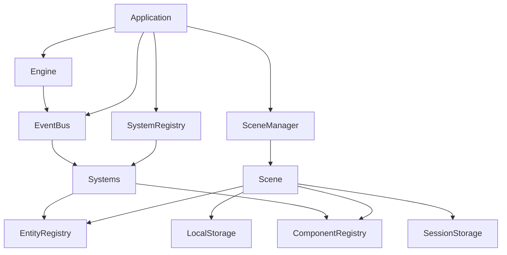
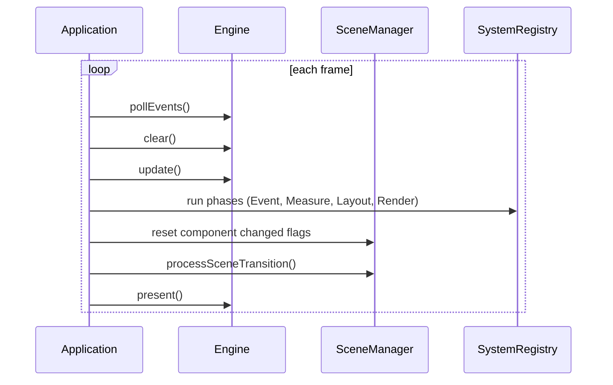
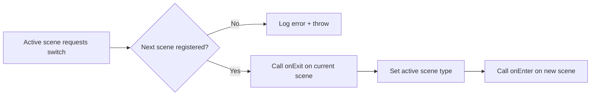

# Guillaume Architecture

Guillaume is organized around an entity-component-system model so UI state,
presentation, and interaction logic stay separate.

## Module Layout

- **Application** owns the engine, scene manager, event bus, and system
  registry, and drives the main loop.
- **SceneManager** owns the registered scenes and handles transitions.
- **Scene** owns an entity registry and a component registry.
- **Systems** read components and traverse entities each frame.
- **EventBus** routes typed events to subscribed listeners and systems.
- **Storage** (`LocalStorage`/`SessionStorage`) provides key-value persistence.

## Frame Lifecycle

The main loop is single-threaded: input → update → render → present.

## Scene Transition Flow

## Patterns Used

| Pattern | Where | Role |
|---|---|---|
| Facade | `Application` | One entry point over engine, scenes, events and systems. |
| Bridge | `utility::Engine` | Platform rendering and input behind an interface the consumer implements. |
| State | `Scene` + `SceneManager` | One active scene; every switch goes through `onExit()` / `onEnter()`. |
| Observer | `event::EventBus`, `event::EventSubscriber` | Engine events fan out to subscribed systems. |
| Strategy | `ecs::LevelOrderTraveler`, `ecs::ReverseLevelOrderTraveler` | Each phase picks its tree traversal order. |
| Template Method | `ecs::System::routine` (`prepare` / `update` / `cleanup`), `EntityBuilderBase::buildEntity` | Fixed skeleton, per-type hooks. |
| Builder | `entities::X::Builder` | Fluent configuration of an entity before it is registered; `makeXxx()` presets cover the common cases. |

## Where Things Are Registered

- **Core systems** are listed once, in `sources/systems/core_systems.cpp`
  (`systems::registerCoreSystems`). `Application` only calls it.
- **Sources** are listed explicitly in `cmake/Sources.cmake` and tests in
  `tests/CMakeLists.txt`; there is no `file(GLOB)`.
- **Style lookups** for the button family live in
  `entities/button_style.hpp` and `entities/fab_style.hpp` as one table row per
  size or variant.
- **Theme tokens** are read through the free accessors in `theme.hpp`
  (`getActiveColor`, `getShapeRadius`, …), which resolve against
  `getActiveTheme()`. Replace it with `setActiveTheme()` before building a
  scene.

## Design Goal

Keep the UI framework composable enough for complex interfaces while keeping
the public API small and predictable.
